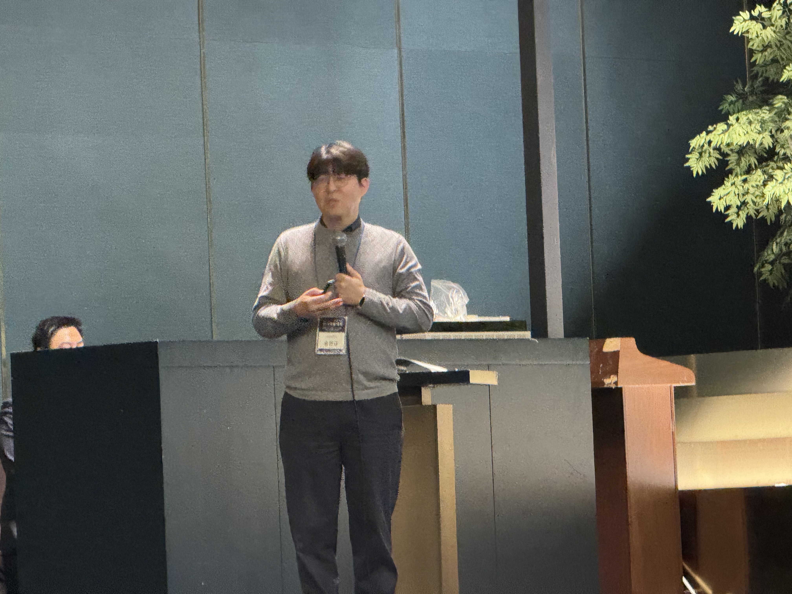
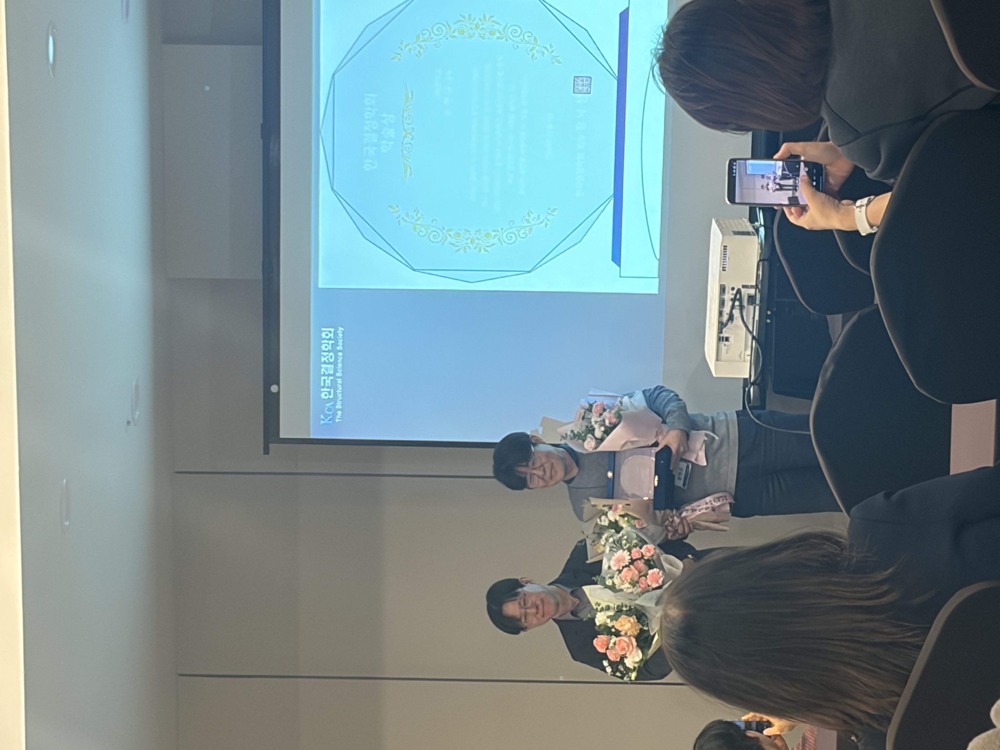
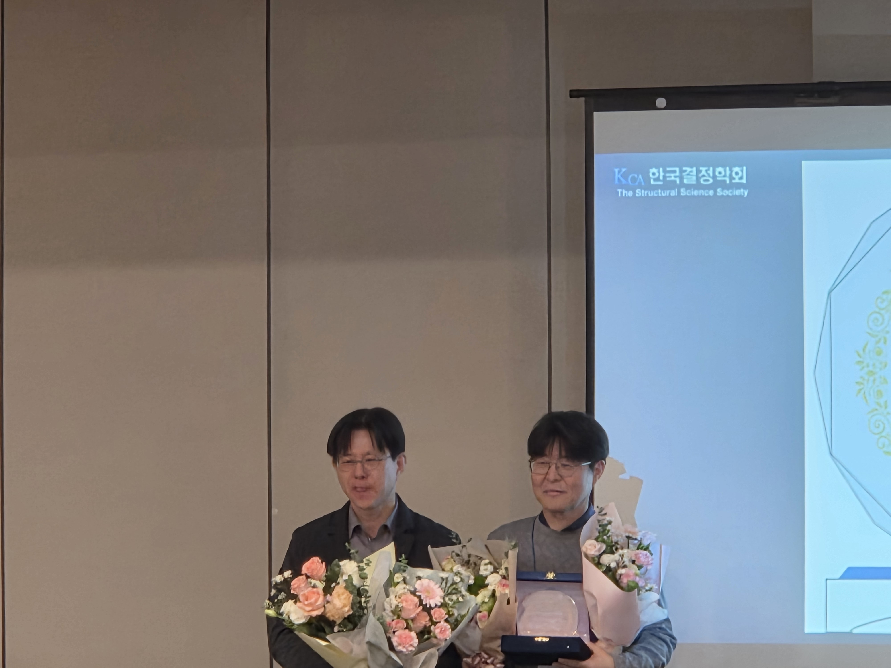
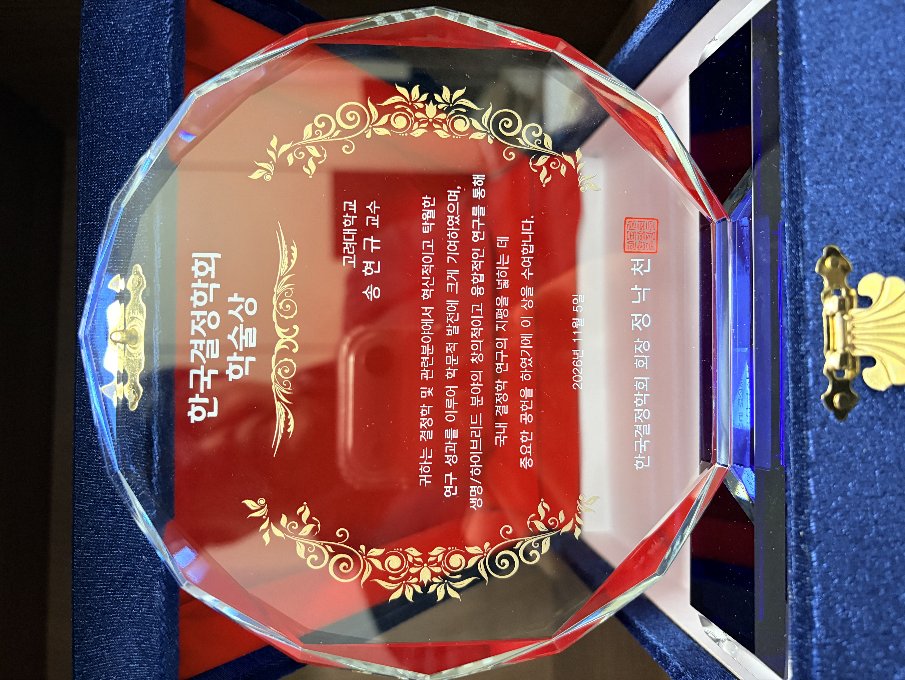

 

 

 

고려대학교 송현규 교수가 2026년 11월 05일 한국결정학회 학술상을 수상하였습니다.
 
이번 학술상은 결정학 및 관련 분야에서 혁신적이고 탁월한 연구 성과를 창출하여 학문발전에 크게 기여하고,
 
생명.하이브리드 분야의 창의적이고 융합적인 연구를 통해 국내 결정학 연구의 지평을 넓힌 공로를 인정받아 수여되었습니다.
 
이번 수상을 계기로 구조생물학과 결정학 분야에서 더욱 의미있는 연구 성과가 이어지기를 기대합니다.
 
수상을 진심으로 축하합니다!

Professor Hyun Kyu Song of Korea University received the __Academic Achievement Award__ from the Korean Crystallographic Association on November 5, 2026.
 
This prestigious award recognizes his outstanding and innovative research contributions to crystallography and related fields, as well as his significant impact on scientific advancement. It also acknowledges his creative and interdisciplinary research in the life and hybrid sciences, which has helped broaden the scope of crystallographic research in Korea.
 
We look forward to seeing his continued contributions to the fields of structural biology and crystallography.
 
__Congratulations on this well-deserved achievement!__

 
 
